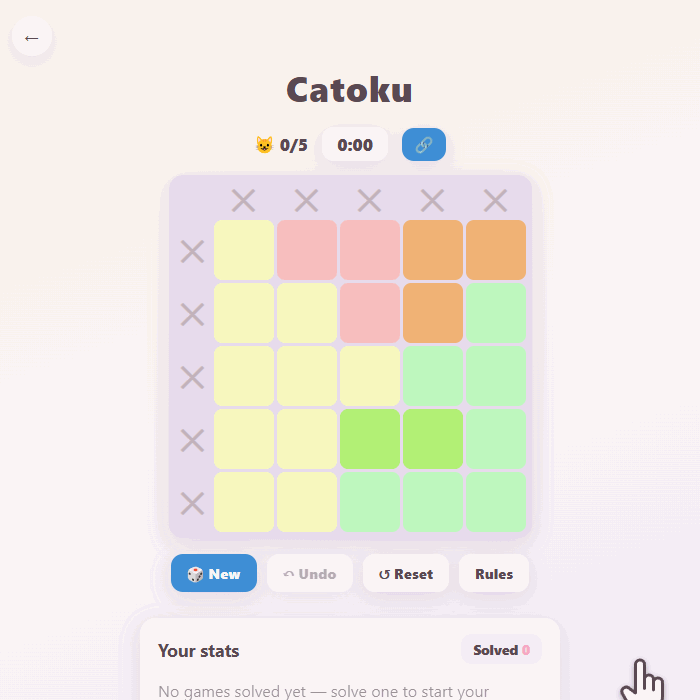
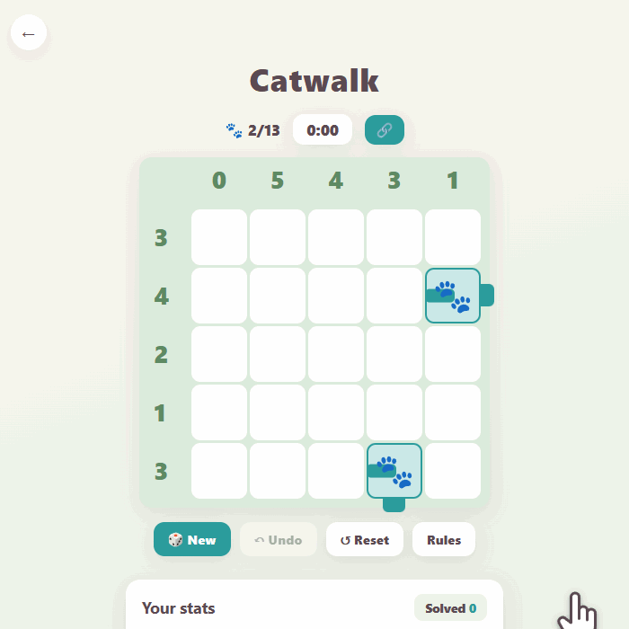
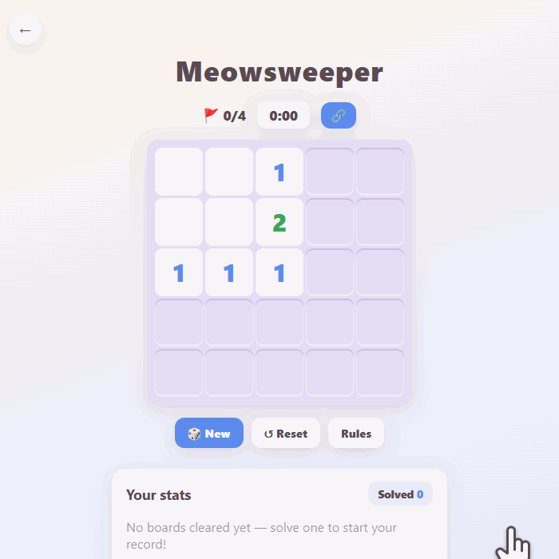
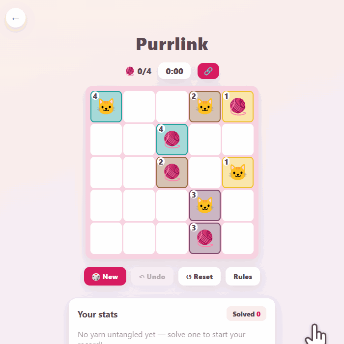
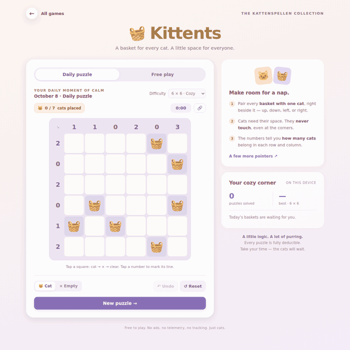

# Kattenspellen

*Kattenspellen* (/ˈkɑtə(n)ˌspɛlə(n)/, "KAH-tuhn-SPEH-luhn") is 🇳🇱 Dutch for "cat games".

Cat themed grid puzzle games, completely free to play, with no ads and no telemetry. Play the daily challenge or generate as many games as you'd like across any difficulty. Keep track of your skill through local-browser stats.

Play at **[kattenspellen.github.io/games](https://kattenspellen.github.io/games/)**.

## Games

<div align="center">

### 🐱 [Catoku](https://kattenspellen.github.io/games/catoku/)

A "Queens"-style logic puzzle with cats. One cat per row, column, and color region.



### 🐾 [Catwalk](https://kattenspellen.github.io/games/catwalk/)

A "Train Tracks"-style logic puzzle. Lay one connected paw trail to match the row and column counts.



### 🙀 [Meowsweeper](https://kattenspellen.github.io/games/meowsweeper/)

A "Minesweeper"-style logic puzzle. Clear every safe tile and flag the spooky things.



### 🧶 [Purrlink](https://kattenspellen.github.io/games/purrlink/)

A "Numberlink"-style logic puzzle. Connect each cat to its ball of yarn — no crossings, fill every square.



### 🧺 [Kittents](https://kattenspellen.github.io/games/kittents/)

A "Tents"-style logic puzzle. Pair each basket with one orthogonally adjacent cat and each cat with one basket. Cats never touch, even diagonally; match the row and column cat counts.

Play the shared daily challenge (based on the UTC date) or choose a fresh board from 5×5 to 9×9 (default 6×6). Outcomes and stats stay in your browser under `kittents_v1`; puzzles are never saved.



</div>

## Kittents self-test

From the repository root, run the 60-board determinism and deduction checks across sizes 5–9 with Node; no browser or dependencies are required:

```bash
node -e '
const fs=require("fs"), vm=require("vm");
const js=fs.readFileSync("kittents/index.html","utf8").match(/<script>([\s\S]*?)<\/script>/)[1];
const box={console,location:{hostname:"localhost",hash:""}};
vm.createContext(box);
vm.runInContext(js,box,{filename:"kittents.js"});
'
```

